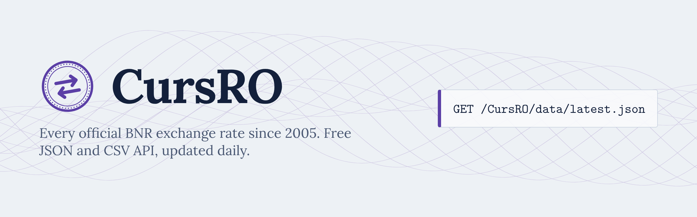

<p align="center">
  
</p>

<p align="center">
  <a href="https://github.com/Robert-GeorgeDev/CursRO/actions/workflows/update.yml"></a>
  <a href="https://github.com/Robert-GeorgeDev/CursRO/actions/workflows/ci.yml"></a>
  <a href="https://robert-georgedev.github.io/CursRO/"></a>
  
</p>

<p align="center">
  <a href="https://robert-georgedev.github.io/CursRO/"><strong>Open the converter and charts</strong></a>
</p>

Every reference exchange rate published by the **National Bank of Romania (BNR)** since 2005, kept in this repository and updated every working day by GitHub Actions. Use it as a free API: plain JSON and CSV files, no key, no sign-up, no server.

```js
const res = await fetch("https://robert-georgedev.github.io/CursRO/data/latest.json");
const { date, rates } = await res.json();
console.log(`1 EUR = ${rates.EUR} lei on ${date}`);
```

## API

All rates are in **lei (RON) for one unit** of the currency. BNR quotes some currencies (such as HUF and JPY) per 100 units; CursRO converts those to one unit, without rounding errors.

| File | What it holds |
| --- | --- |
| [`data/latest.json`](https://robert-georgedev.github.io/CursRO/data/latest.json) | The most recent day, plus the day before it |
| `data/daily/<year>/<date>.json` | One day, for example [`data/daily/2025/2025-01-03.json`](https://robert-georgedev.github.io/CursRO/data/daily/2025/2025-01-03.json) |
| `data/currencies/<CODE>.json` | Full history of one currency, for example [`data/currencies/EUR.json`](https://robert-georgedev.github.io/CursRO/data/currencies/EUR.json) |
| [`data/rates.csv`](https://robert-georgedev.github.io/CursRO/data/rates.csv) | Every rate in one file: `date,currency,rate` |
| [`data/index.json`](https://robert-georgedev.github.io/CursRO/data/index.json) | Available currencies and the date range |

Base URL: `https://robert-georgedev.github.io/CursRO/data/`. The same files are in the [`data`](data) folder of this repository.

### Shapes

```jsonc
// latest.json (values shortened for the example)
{
  "date": "2026-10-27",
  "base": "RON",
  "source": "Banca Națională a României (https://www.bnr.ro)",
  "rates": { "EUR": 5.0812, "HUF": 0.013071, "USD": 4.3701 },
  "previous": { "date": "2026-10-26", "rates": { "EUR": 5.0791 } }
}

// currencies/EUR.json: one [date, rate] pair per published day, oldest first
{ "currency": "EUR", "base": "RON", "rates": [["2005-01-03", …], ["2005-01-04", …]] }
```

There is no rate on weekends and public holidays, because BNR does not publish one. Look for the most recent date on or before the day you need.

## How it works

1. A [scheduled workflow](.github/workflows/update.yml) runs every working day after BNR publishes, at about 13:00 Romanian time, plus a later backup run.
2. [`scripts/update.mjs`](scripts/update.mjs) downloads BNR's ten-day file and adds any missing days. After a longer gap it fills the hole from BNR's yearly archives; on the very first run it downloads everything since 2005.
3. [`scripts/check-data.mjs`](scripts/check-data.mjs) checks the files before anything is committed. If BNR changes its format, the update stops instead of saving bad data.
4. The new data is committed and the site is redeployed to GitHub Pages.

No dependencies: only Node.js 20 or newer.

```bash
npm test          # parser and update tests, with BNR-format fixtures
npm run update    # download missing rates into data/
npm run check     # validate the data folder
npm run site      # build the site into _site/
```

## Source and disclaimer

The rates are published by [Banca Națională a României](https://www.bnr.ro). CursRO is an independent project, not affiliated with BNR. The data is provided as is; for official or legal use, check the values on bnr.ro.

## Contributing

Bug reports and ideas are welcome in [issues](https://github.com/Robert-GeorgeDev/CursRO/issues). See [CONTRIBUTING.md](CONTRIBUTING.md).

## License

The code is [MIT](LICENSE). The exchange rates come from BNR; see [Source and disclaimer](#source-and-disclaimer).
